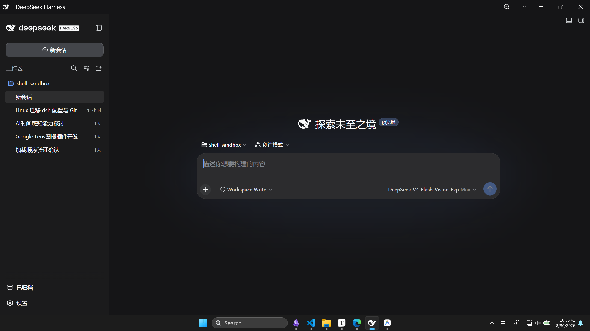

# dsh-desktop

<p align="center">
  <b>DeepSeek Harness (<code>@deepseek-ai/dsh</code>) 的原生 Windows 桌面启动器</b><br>
  点击快捷方式 = 在指定目录执行 <code>dsh web --no-open</code>，解析本次进程 token，最大化打开 Edge 应用窗；窗口收进托盘常驻，托盘菜单退出时才回收后台。
  <br><br>
  <a href="https://github.com/2bitbit/dsh-desktop/releases/latest"></a>
  <a href="LICENSE"></a>
  
  
  <br>
  <a href="README.md.en">English</a>
</p>

<p align="center">
  
</p>

> [!IMPORTANT]
> **仅限 Windows 10 1607+ / 11 x64**。依赖 Win32 GUI、Job Object、WinEventHook、低层输入钩子、每显示器 DPI 感知 v2，以及本机已安装的 Microsoft Edge。
>
> **不需要**在 Edge 里预先安装任何应用：本程序用 `msedge.exe --app=<tokenUrl>` 直接开独立窗口。

---

## 做什么

`dsh web` 从 0.1.2 起在根路径强制认证：每次启动都会打印带 `?token=` 的一次性 URL，浏览器用它换 cookie 后再进界面。无 token 直接打开 `http://127.0.0.1:3080/` 会 401。

本仓库把这条链路收成一个无控制台 exe：

1. 单实例检查：已有实例在跑时，只把它的窗口前置，然后自己退出。
2. 立刻弹出原生启动窗（可取消）。
3. 直通 pnpm 的 `node.exe` 跑 `dsh web --no-open`，stdout 进管道。
4. 解析 `dsh web: http://127.0.0.1:<port>/?token=...`。
5. 只打开一次 Edge `--app=<tokenUrl>`，并最大化；随后挂出托盘图标。
6. 窗口关掉（叉号 / Alt+F4 / Ctrl+Shift+W）只是**收进托盘**，后台继续跑。
7. 托盘菜单「退出」→ Job Object 秒杀 node 进程树，端口立刻释放。
8. 托盘菜单「重启」→ 原样重启后台（窗口与托盘不动）；dshmarket 里的「重启」同样能正常完成。

---

## 关闭与重启

| 操作 | 结果 |
| :--- | :--- |
| 左键点标题栏叉号 | 收进托盘，后台继续运行 |
| `Alt+F4`（应用窗口在前台） | 同上 |
| `Ctrl+Shift+W`（应用窗口在前台） | 同上 |
| 左键单击托盘图标 / 再次运行 exe | 前置已有窗口 |
| 右键托盘图标 → 显示窗口 | 同上 |
| **右键托盘图标 → 重启后台** | **回收后台并原样重启，窗口与托盘图标不动** |
| **再运行一次 exe 并带 `--restart`** | **同上（等价于托盘那一项，方便做快捷方式）** |
| 在 dshmarket 里点「重启」 | 后台重启，页面自行重连（启动器不再误杀重启助手） |
| 右键托盘图标 → 退出并结束后台 | 关窗口 + 杀后台进程树 + 移除托盘图标 + 退出 |
| 窗口被其它途径销毁（任务栏预览关闭、浏览器崩溃等） | 同样回收后台再退出，不留僵尸进程 |

三条「收进托盘」的路径都不弹任何通知，也不会让后台进程退出。

热键只在**应用窗口处于前台**时才拦，不会抢其它程序的 `Alt+F4` / `Ctrl+Shift+W`。

### 重启是怎么做到的

后台主进程退出后，启动器**不会立刻回收**，而是先进「重启观察窗」（默认 30 秒）：

1. 只要**端口重新有人监听** → 认为重启成功，改用新进程继续监督，托盘图标与窗口保持不动；
2. 作业里已无存活进程、或观察窗超时 → 才按真正结束处理，走彻底回收。

判据是「端口」而不是「主进程句柄」，因为 dshmarket 的重启姿势是：主进程自杀，由一个**脱离进程的助手**在端口释放后拉起替补。实测确认这类助手仍在启动器的 Job Object 里，所以盯主进程句柄会把它们一起误杀——这正是 v2.3.0 之前「点重启 → 托盘没了、页面一直转圈」的原因。


重启后应用窗口**不需要你手动关**：托盘那条路会**自动把窗口换成新页面**（用新 token 重开一个，再关掉旧的；旧窗口当时若收在托盘里，新窗口沿用同一状态，不打扰你）。两种发起方：

| 谁发起重启 | 后端 | 页面 |
| :--- | :--- | :--- |
| 托盘「重启后台」/ `--restart` | 换成新进程 | **换成新窗口**：等价于整页刷新，新页面 + 新客户端代码 |
| dshmarket 的「重启」 | 换成新进程 | **换成新窗口**：启动器从市场自己的重启日志里取替补 host 的新 token，用它开新窗关旧窗 —— 页面必然已鉴权（新 token 的兑换无条件成功）|

**为什么托盘那条也要换窗口**：只换后台、页面仅重连的话，前端会停在旧客户端代码上；而且会踩到「主机投影还是冷的」这条竞态——`dsh-notification` 把每个已完成 session 的旧回合当成新回合，重启后弹一串通知。换新窗口就与整页重载等价了。

托盘重启后若界面没起色（例如某个 bundle 取不到导致那个插件没同步上），在窗口里按一下 **Ctrl+R** 即可——窗口一直在，随时可刷。

---

## 快速使用

### 1. 前提

- Windows 10 1607+ / 11 x64，已安装 Microsoft Edge
- 已全局安装 dsh **≥ 0.1.2**：`pnpm add -g @deepseek-ai/dsh`

### 2. 安装快捷方式

下载 [最新 Release 压缩包](https://github.com/2bitbit/dsh-desktop/releases/latest) 解压后，在 PowerShell 中执行：

```powershell
# 交互模式：弹出文件夹选择框
.\install_shortcut.ps1

# 指定工作目录与快捷方式名称
.\install_shortcut.ps1 -TargetDirectory "D:\Workspace\MyProject"
```

会在**桌面与开始菜单**各放一个快捷方式。点击它 = 在该目录执行 `dsh web --no-open`，等 token 就绪后打开最大化的 Edge 应用窗。

托盘图标取自 exe 内嵌资源（`src/tray_icon.ico`），快捷方式图标同样用的是它。

---

## 生命周期

```
快捷方式 (--cwd <dir>)
        │
        ▼
dsh_desktop.exe ── 单实例检查（已有实例 → 只前置窗口，然后本进程退出）
        │
        ├─ 启动窗
        │
        ├─ Job Object ──▶ node (dsh web --no-open)
        │                     │
        │                     └─ stdout: dsh web: http://127.0.0.1:<port>/?token=***
        │
        ├─ Edge --app=<tokenUrl>  （最大化）
        │
        ├─ 托盘图标常驻
        │
        ├─ 叉号 / Alt+F4 / Ctrl+Shift+W ──▶ 隐藏到托盘（后台照常跑）
        │
        ├─ 托盘「重启」/ --restart / dshmarket 的重启
        │        └─▶ 进「重启观察窗」：等端口重新被监听
        │               ├─ 回来了 ──▶ 改用新进程继续监督（托盘与窗口不动）
        │               └─ 没回来 / 作业已空 ──▶ 按真正结束处理
        │
        └─ 托盘菜单「退出」 ──▶ TerminateJobObject ──▶ 回收进程树 / 释放端口
```

运行期间用 `SetWinEventHook` + `MsgWaitForMultipleObjects` 挂起，**0 轮询 / 0% CPU**。

叉号之所以能被拦下：程序挂了一个 `WH_MOUSE_LL` 低层鼠标钩子，左键按下时若点在窗口顶部带内，就向应用窗口问一次 `WM_NCHITTEST`；Chromium 会为自绘标题栏如实回答，关闭按钮返回 `HTCLOSE`。只有拿到 `HTCLOSE` 才吞掉这次点击并隐藏窗口，页面内的普通点击不受影响。

---

## 常用参数

| 参数 | 说明 | 示例 |
| :--- | :--- | :--- |
| `--cwd <path>` / `-w <path>` | 后台 dsh 工作目录 | `dsh_desktop.exe --cwd "D:\Projects\Demo"` |
| `--debug` / `-d` | 调试日志 + 失败弹窗 | `dsh_desktop.exe --debug` |
| `--restart` | 让正在运行的实例重启后台（等价于托盘菜单「重启后台」） | `dsh_desktop.exe --restart` |

exe 同级会写两份日志（每次启动清空，运行中追加并限大小；token 脱敏）：

| 文件 | 内容 | 上限 |
| :--- | :--- | :--- |
| `dsh_desktop.log` | 启动器自身日志 | 512 KB |
| `dsh_web_console.log` | `dsh web` 的 stdout/stderr | 2 MB |

---

## 源码编译

需要 MinGW-w64 / LLVM Clang / MSVC 之一，以及配套的资源编译器（`windres` 或 `rc.exe`）：

```powershell
.\scripts\build.ps1
```

脚本会先把 `src/dsh_desktop.rc`（内嵌托盘图标 `src/tray_icon.ico`）编译成资源对象，再连同 `src/dsh_desktop.cpp` 一起链接。

产物：`bin/dsh_desktop.exe`。GCC 路径用 `-static -static-libgcc -static-libstdc++` 静态链接，成品不依赖 MinGW 运行时 DLL。

> GCC 路径已在 MinGW-w64 GCC 15 上实测；Clang / MSVC 两条路径未实测。

---

## 版本沿革

见 [CHANGELOG.md](CHANGELOG.md)。

---

## 协议

[MIT License](LICENSE)
